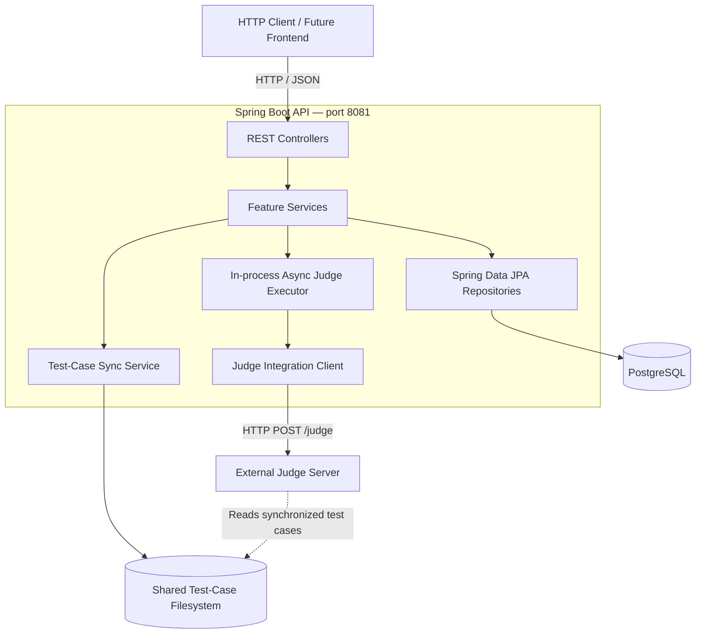
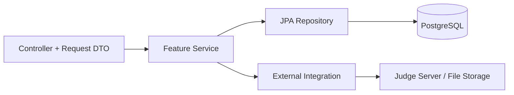
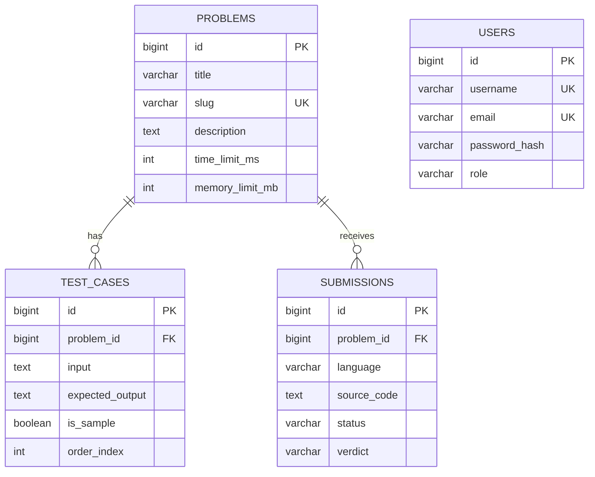
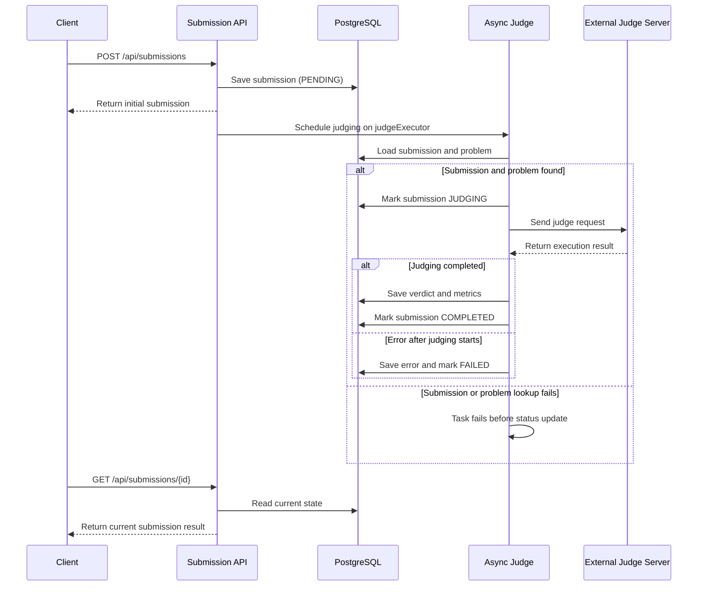
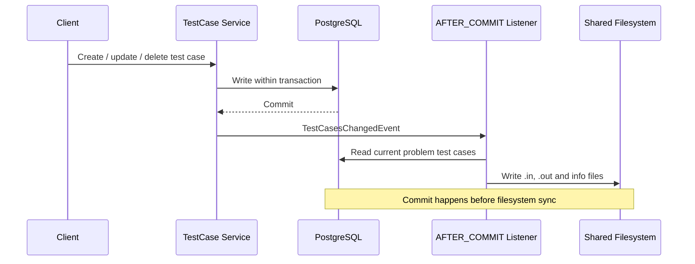

# CodeForge — System Architecture

> **Status:** Current repository implementation snapshot
> **Scope:** Repository architecture, runtime flows, integration contracts, and known limitations.
> **Source:** Backend source, migrations, configuration, and repository structure. Planned
> features are not described as implemented.

## 1. Overview and implementation status

CodeForge is an Online Judge application for managing programming problems, executing code and evaluating submissions. The **implemented runtime** is a Java 25 / Spring Boot backend backed by PostgreSQL and integrated with an external Judge Server. The repository has a full-stack layout, but the current implementation is backend-only: frontend and standalone worker applications are **not implemented** in the inspected repository snapshot.

| Component | Responsibility | Current status |
| --- | --- | --- |
| Spring Boot API | HTTP endpoints, validation, application logic, persistence and orchestration | Implemented |
| PostgreSQL | Problems, test cases, submissions and user accounts | Implemented schema via Flyway |
| External Judge Server | Compile/execute code and evaluate against test cases | Integrated through HTTP |
| Shared test-case storage | Materialize database test cases in Judge Server file format | Implemented |
| Authentication | User registration and BCrypt password storage | Partially implemented; no login/token issuance |
| Authorization | Route-level access control | Not implemented; routes are currently public |
| Frontend | User-facing web application | Placeholder only |
| Standalone worker | Separate background judging process | Placeholder only; judging currently runs in backend |

## 2. High-level architecture



The Spring Boot application is the orchestration boundary. It handles API requests and writes database state. The external Judge Server performs code execution; the backend does not execute untrusted submissions directly. The storage volume must be accessible wherever the Judge Server expects its test cases.

**Deployment note:** `infra/compose.yml` in the inspected snapshot provisions PostgreSQL only. The diagram describes runtime dependencies, not a claim that the complete stack is provisioned by this Compose file.

## 3. Technologies and repository organization

### 3.1 Technology stack

| Area | Technology / approach |
| --- | --- |
| Runtime | Java 25, Spring Boot (source snapshot lists 4.0.8) |
| HTTP and validation | Spring Web MVC, JSON, Jakarta Bean Validation |
| Persistence | Spring Data JPA / Hibernate, PostgreSQL |
| Schema migration | Flyway; `ddl-auto=validate` |
| Security foundation | Spring Security; BCrypt password encoding |
| Judge communication | Spring `RestClient` |
| Background processing | Spring `@Async` and configured `judgeExecutor` |
| Development and testing | Maven, H2 for tests, Spring Boot test starters |

### 3.2 Repository map

```text
CodeForge/
├── backend/
│   ├── src/main/java/com/codeforge/backend/
│   │   ├── auth/          # Registration
│   │   ├── user/          # Users and roles
│   │   ├── problem/       # Problem CRUD and code runs
│   │   ├── testcase/      # Test-case CRUD and sync events
│   │   ├── submission/    # Submission persistence and judging
│   │   ├── judge/         # Judge protocol and test-case storage
│   │   ├── security/      # Spring Security configuration
│   │   ├── config/        # Async executor configuration
│   │   └── common/        # Shared errors and pagination
│   ├── src/main/resources/db/migration/
│   ├── src/main/resources/judge/
│   └── src/test/
├── frontend/              # Placeholder in inspected snapshot
├── worker/                # Placeholder in inspected snapshot
├── infra/compose.yml      # Local PostgreSQL
└── state/                 # No tracked implementation in snapshot
```

The backend uses **package-by-feature** organization; within each feature, controller, DTO, service, repository and model classes are grouped together. Shared technical concerns are placed in `common`, `config` and `security`.

## 4. Backend design

### 4.1 Logical layers



- **Controllers:** Parse HTTP input, run validation and delegate to services; return response DTOs or paginated results.
- **Services:** Implement domain behavior, transaction boundaries and cross-component orchestration.
- **Repositories:** Manage database access using Spring Data JPA.
- **Integrations:** Translate application requests into Judge Server protocol calls or judge-compatible test-case files.
- **Common infrastructure:** Centralize error responses and pagination validation.

The `TestCase.problemId` and `Submission.problemId` Java fields are scalar foreign-key identifiers rather than JPA entity associations. Database foreign keys still enforce referential integrity.

### 4.2 Feature responsibilities

| Feature | Main responsibility |
| --- | --- |
| `problem` | Create/list/read problems and run code on user-supplied input |
| `testcase` | CRUD test cases; emit change events for synchronization |
| `submission` | Persist submissions; queue background judging; read results |
| `judge` | Judge Server client, language configs, verdict mapping, test-case storage |
| `auth`, `user` | Registration, user records, BCrypt hashing and role persistence |
| `security` | Current stateless security baseline; route protections not yet present |

## 5. Data architecture

Flyway migrations **V1–V7** are the schema source in the inspected snapshot. Hibernate validates schema rather than creating/updating it at runtime.



The diagram shows core fields rather than every column. The database also stores timestamps and submission execution diagnostics, including passed/total test-case counts and failed-case details. Users currently have **no established submission relation** in the inspected schema.

### State and verdicts

- A new submission is persisted as `PENDING`.
- Background judging moves it to `JUDGING`, then `COMPLETED` or `FAILED`.
- Verdicts include `AC`, `WA`, `TLE`, `MLE`, `RE`, `CE` and `SE`.

**Important distinction:** `status` describes processing lifecycle, while `verdict` describes the evaluation outcome.

## 6. Core runtime workflows

### 6.1 Submission judging (asynchronous)



The user-facing create request does not synchronously wait for final judging. The inspected executor has **2 core threads, 4 maximum threads and queue capacity 50**. These are configuration details that should be revisited when tuning throughput. The submission and problem lookups occur before the `try` block in `SubmissionJudgeService`; if either lookup fails, the task fails before it can mark the submission `FAILED`, so the submission may remain `PENDING`.

The executor is bounded, but the source does not define or document an explicit queue-rejection policy. Queue saturation behavior requires runtime testing.

### Judge Server contract

The backend treats the external Judge Server as an HTTP integration boundary:

- `JudgeClient` sends `POST /judge` requests using JSON.
- Submission judging sends source code, a language configuration, execution limits,
  the `codeforge_<problemId>` test-case directory identifier, and a flag to use
  test cases.
- One-off runs send one inline input test case instead of a synchronized directory.
- Supported language identifiers are `cpp`, `java`, and `python`; their configurations
  are loaded from `cpp20.json`, `java21.json`, and `python3.json`.
- A `CompileError` response becomes a `CE` submission verdict. Other non-null judge
  errors or malformed responses fail the judging operation.
- Judge result codes are mapped to `WA`, `TLE`, `MLE`, `RE`, and `SE`; result code
  `0` is treated as passed.
- The client sends the SHA-256 hash of `judge.server.token` in the
  `X-Judge-Server-Token` header.
- Synchronized files use `<testCaseId>.in`, `<testCaseId>.out`, and an `info` file
  under `judge.storage.path/codeforge_<problemId>`.

The exact request and response DTO shapes remain defined by the Java records under
`backend/src/main/java/com/codeforge/backend/judge/dto/` and by the external Judge
Server implementation.

### 6.2 Test-case synchronization



Files are written beneath `judge.storage.path`, under a `codeforge_<problemId>` directory. The storage implementation uses temporary files and atomic replacement where supported.

**Consistency boundary:** A synchronization failure is logged but does not undo the committed database change. Database and filesystem state may therefore diverge indefinitely because the current source does not establish an automatic retry, startup reconciliation, or manual resync mechanism. Since submissions depend on the synchronized test-case directory, stale filesystem state can affect later judging.

### 6.3 Run code (one-off)

`POST /api/problems/{id}/run` validates the problem and language, submits code with one user-provided input to the Judge Server, and returns the immediate run result. It does **not** create a persisted submission.

### 6.4 Registration

`POST /api/auth/register` validates and normalizes account data, checks username/email uniqueness, hashes passwords with BCrypt and stores users. Password hashes are not exposed in the user response. Login, token issuance and current-user retrieval are **not implemented** in the inspected snapshot.

## 7. Security architecture — current state

- Spring Security is configured as **stateless**.
- CSRF, form login and HTTP Basic are disabled.
- The configured password encoder is **BCrypt**; registration enforces BCrypt's 72-byte password input limit.
- User roles `USER` and `ADMIN` exist in persistence.
- **All HTTP routes are presently permitted.** Registration alone does not provide an authenticated session or effective authorization.
- Under this configuration, submission lists and individual submission details are
  globally readable, and submission creation is not associated with an authenticated user.
- The Judge Server client sends the configured authentication token as a SHA-256 hash in the `X-Judge-Server-Token` header.

**Planned / not yet implemented:** login, token generation and validation, identity extraction for requests, endpoint authorization and user-to-submission ownership. These should be documented as implemented only after source changes are verified.

## 8. API and error conventions

Main API groups in the inspected snapshot:

| API group | Representative endpoints |
| --- | --- |
| Health | `GET /api/health` |
| Auth | `POST /api/auth/register` |
| Problems | `POST /api/problems`, `GET /api/problems`, `GET /api/problems/{id}` |
| Run | `POST /api/problems/{id}/run` |
| Test cases | Nested CRUD under `/api/problems/{problemId}/test-cases` |
| Submissions | `POST /api/submissions`, `GET /api/submissions`, `GET /api/submissions/{id}` |

List endpoints use Spring Data pagination and shared pagination validation. Problem list defaults to size 20 with a maximum of 100 in the inspected implementation.

Centralized error handling uses an `ApiErrorResponse` structure with `timestamp`, `status`, `error`, `message`, `path` and optional `fieldErrors`. Unexpected errors are logged and returned as generic HTTP 500 responses. Complete parameter contracts are better maintained in OpenAPI or an API reference than duplicated here.

## 9. Configuration and deployment

The backend's `application.properties` configures the HTTP port (`8081`), datasource/environment overrides, JPA validation, pagination, Judge Server URL/token and test-case storage path. Language-specific judge configuration is held in `cpp20.json`, `java21.json` and `python3.json`.

**Local environment detail requiring alignment:** The inspected `infra/compose.yml` exposes PostgreSQL on `127.0.0.1:5433`, while the backend datasource property defaults to `5432`. Local connection overrides must reconcile them.

The Judge Server and shared storage must be set up independently of the PostgreSQL-only Compose file in this snapshot. Do not assume `docker compose up` under `infra/` launches the entire Online Judge stack.


### 9.1 Judge Server Infrastructure

CodeForge integrates with the open-source Judge Server
from the QingDaoU OnlineJudge project.

The Judge Server is deployed using Docker-based
infrastructure based on QingDaoU's OnlineJudgeDeploy.

This infrastructure is maintained separately from
the main CodeForge repository.

#### Responsibility Boundaries

- **CodeForge:** REST APIs, database management,
  business logic, submission orchestration,
  and application security.
- **QingDaoU Judge Server:** Sandboxed compilation
  and execution, resource limits, and judging.
- **OnlineJudgeDeploy:** Docker configuration,
  Judge Server deployment, and runtime setup.

The Judge Server is treated as an external service
and communicates with the CodeForge backend via HTTP.

#### Upstream Projects

- https://github.com/QingDaoU/OnlineJudge
- https://github.com/QingDaoU/OnlineJudgeDeploy


## 10. Architectural decisions and trade-offs

The table distinguishes **observed implementation choices** from **interpretations** of their benefits and costs. Rationale is proposed documentation, not a claim about the original author's intent.

| Observed choice | Likely benefit / rationale | Trade-off |
| --- | --- | --- |
| Package-by-feature backend | Keeps feature logic easy to find and change | Requires consistent boundaries for shared utilities |
| PostgreSQL with Flyway | Explicit, repeatable schema evolution | Migrations need version discipline |
| Scalar FK fields in JPA models | Avoids implicit entity graph loading | Services perform related-entity lookups explicitly |
| In-process `@Async` judging | Simple, quick response from submission API | Queue and running tasks depend on backend process lifecycle |
| DB-to-filesystem test-case sync after commit | Keeps DB transaction separate from filesystem writes | Can produce temporary/persistent inconsistency on sync failure |
| External Judge Server | Isolates execution responsibilities from core business API | Requires network access, compatible protocol and test-case storage |
| Stateless Spring Security baseline | Supports a future token-based request model | Does not secure endpoints until authentication is implemented |

## 11. Known limitations and risks

These are current-state observations or design risks, **not** assertions that a failure has already occurred:

1. **Unprotected APIs:** No active authentication/authorization enforcement yet.
2. **Backend-local async tasks:** A process restart can interrupt ongoing work; startup recovery is not documented in the inspected source summary.
3. **Executor capacity:** Queue saturation and rejection behavior require explicit testing/documentation.
4. **Test-case synchronization:** Post-commit filesystem errors cannot roll back database writes; retry/reconciliation behavior is not established.
5. **External runtime dependency:** Judge failures, timeouts and service unavailability affect evaluation reliability; concrete retry policy should be verified in implementation.
6. **Incomplete presentation layer:** `frontend/` and `worker/` are placeholders, not operational services.
7. **Limited automated coverage:** The inspected repository records a Spring context test but no documented feature-level API or judging tests.

## 12. Documentation maintenance

Update this document when the architectural shape changes, especially when:

- JWT/login and role-based protection are implemented.
- `submissions` become associated with authenticated users.
- Frontend or standalone worker modules are introduced.
- Judging moves from in-process `@Async` to a durable message queue or worker service.
- Judge Server deployment/storage or test-case sync semantics change.

Keep exact endpoint payloads in an API reference and detailed schema columns in migrations or database documentation. For major decisions, add a dedicated Architecture Decision Record (ADR) with **context, decision, alternatives and consequences**.

---